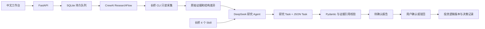

> 下文保留早期实施记录。2026-10-06 的部署升级已将业务记录和 CrewAI 任务输出切换为 MySQL，新增 `/crew/` 构建前缀与管理员登录；当前启动与迁移步骤以 README 为准。

# 项目检查与实施记录

检查日期：2026-09-25。

## 原项目实况

`/Users/brown/program/stock-监控` 约 4.4 MB，是设计文档与人工研究档案，不是已有的 Web 服务。包含公司/证券/行业对象、截图投稿与观点、中央编号表、英伟达人工试点报告和 17 条原始证据。未发现应用入口、依赖文件、后台调度器和 Docker 配置。`/Users/brown/program/www/crew-stock` 开始时为空。

文档中的“先给清单、不要写文件、先不要创建定时任务”等内容属于历史流程说明和示例，不作为本次用户已授权实施的阻断条件。保留了设计里的证据追溯、公司/证券分离和人工确认原则。

## 运行架构

UI→API→持久队列→真实 CrewAI→证据/报告→UI 全路径已接通。应用只有一个队列消费者；文件锁拒绝同一数据卷上的第二个进程。普通工具无法访问 shell 任意命令、任意文件或长桥写入能力。

## 设计映射

| 原设计 | 本版结果 |
| --- | --- |
| 公司与证券拆分 | 已实现，支持多个证券并保证证券唯一归属 |
| 编号与证据哈希 | 已实现，旧编号保留，新编号通过事务分配 |
| YAML/CSV 文件主库 | 迁移为 SQLite 主索引，保留原始导入文件；新证据与报告有 JSON 快照 |
| 原始证据、来源与时间 | 已实现；业务日期未知时保留 null，不拿采集时间代替 |
| 增量变化 | 同工具同证券同参数跨次结构比较；不宣称完成了跨期会计口径对齐 |
| 精确财务计算 | 对可比较标量用 Decimal 算差值；完整同比/环比/估值建模尚未实现 |
| 研究判断及人工确认 | 已实现；引用必须存在、成功且属于本次上下文，确认记录不可覆盖 |
| 投资逻辑版本 | 已实现，报告与人工决定构成历史，当前公司仅保存已确认版本引用 |
| 外部观点与个人批注 | 文本录入与旧截图保留；v0.3 新增文件/图片解析入口，原件与识别结果分别保存 |
| 定时采集/研究 | 已实现间隔计划，创建后暂停，显式启用；无外部消息推送 |
| 行业与人物对象 | v0.3 新增独立行业、公司成员引用、行业批次汇总与周期计划；公众人物独立关系通道未实现 |
| 管理层承诺 | v0.2 已实现提取、核对、量化目标/定性条件、数值检查与不可覆盖的评价台账 |
| 供应链、加权影响图、冲击模拟 | v0.3 已实现交互图、证据引用、AI 候选、人工审核、权重版本及有界情景计算；未经经济数据校准 |

## v0.1 初始验证记录（历史）

- 本机原有长桥 CLI `0.26.0` 未授权；独立容器使用 `0.28.7`，初始同样未授权。
- 没有发现可供本项目使用的 DeepSeek 环境变量凭据。应用在未配置时阻止研究入队，允许只采集模式返回可追溯的真实授权错误。
- 自动化验证使用真实 CrewAI Flow/Agent/Task，模型替身只替代外部模型响应；同时拦截 HTTP 请求验证 DeepSeek `model`、`max_tokens`、`thinking` 参数。不能将这些测试说成真实 DeepSeek 已生成报告。
- 实际容器内执行过一次长桥只读采集，产生 `run-000002` 和 8 条失败记录，错误为未授权。没有将历史数据回退成“新行情”。这条记录保留在运行列表中供检查。
- 已验证 Docker 健康检查、非 root 身份、只读应用目录、独立可写数据/授权卷及浏览器历史档案查看。
- 最终自动化测试：25 项通过；Ruff 检查及格式检查通过；前端 JavaScript 语法检查通过。依赖内部有弃用警告，不影响本次通过结果。
- 在运行镜像内部通过临时数据与脚本模型执行了真实 CrewAI Flow、工具调用、两个 Task、引用校验及报告落库，打印 `CONTAINER_SMOKE_OK`。
- 重启容器后，25 条证据（17 条历史 + 8 条真实未授权失败记录）、2 次运行及原始证据文件哈希保持一致。导入的源档案逐文件与原目录一致。

## 有意保留的局限

- 文本语义是否忠实仍需人工审阅；程序能验证引用合法性，不能证明所有自然语言结论都为真。
- 只有本机用户访问，没有多用户账号/RBAC。若将端口暴露到网络，需要另外设计身份认证。
- 命令数据可能截断进入提示词，完整原始响应始终可追溯，Agent 可分段读取。
- 对不同传输或不同参数的历史响应不自动宣称可比。首次新 CLI 采集建立 CLI 基线，后续采集才比较。
- 定时器随此容器运行，单消费者顺序执行；不是分布式任务系统。
- 历史导入为一次性初始化；不会监视或回写旧项目目录。

## v0.2 研究记录扩展

- 新增 `workspace_models.py`、`workspace.py`、`workspace_api.py`、`discovery.py` 和 `web/workspace.js`，保留原队列、证据主库及 Docker 卷。
- 新对象类型：披露摘要、管理层承诺、经营指标、指标审阅、承诺评价、供应商预期快照、投资逻辑版本、投资决策、复盘、原始文档、竞对组及成员版本。源记录保持不可覆盖，评价/复盘另追加。
- 最新研究会分别查询三张财务报表、财报概览、行业排名，扩大公告发现范围并选择最多四份相关正文；电话会搜索结果必须匹配公司标识，避免把其他公司的会议当成本公司资料。CLI 调用上限 24 次。
- DeepSeek 分为有只读工具的研究 Agent 与无工具的结构化整理 Agent；均在 CrewAI 中运行。限制工具轮次并缩短初始证据摘要，完整证据可分段读取。
- 模型字段来源校验失败时不纳入结构化台账，并加入缺口。旧版待确认提取记录经同样校验，不合格项保留原数据及系统驳回审计记录。
- 单次供应商响应里的 Beat/Miss 只记录供应商口径；本地预期比较采用严格时点校验。不会跨币种、跨口径或跨日历期间自动排名。
- 上传输入目前为粘贴文本或 TXT/Markdown/CSV/JSON 文本。网址仅作为来源元数据，不会向任意 URL 发请求；没有 PDF/OCR/音频转写。
- 现有研究数据库在升级前使用 SQLite backup API 备份到容器 `/data/backups/pre-workspace-*.sqlite3`；没有更换卷、重置授权或删除既有记录。

最新验收：42 项测试通过；真实 DeepSeek 同步/异步结构化调用通过；最终完整研究 `run-000010` 生成 `rpt-000004` 并落库三条通过校验的财报整理记录，状态为完成但有数据缺口。完整细节与失败修复过程见 [v0.2 验证记录](VERIFICATION.md)。

## v0.3 行业、资料与图谱扩展

- `industries.py`：独立行业对象和修改版本；行业批次冻结成员列表，串行排队公司研究，失败保留，最后使用 CrewAI + DeepSeek 汇总。行业任务与公司的定时任务共用单一后台工作进程。
- `assets.py`：有界文件读取、PDFium 渲染、Office 文字提取、DeepSeek 图片/文本解析，原始文件与 AI 衍生证据分别保存，按页/表追溯。重启中断可重试。
- `influence.py`：永久关系 ID、六因子评分、逐字引用校验、模型/人工建议与确认状态、不可覆盖的版本记录；确认关系用于有向有界路径计算，情景冻结全部关系参数。
- `extended_api.py` 与 `web/extensions.js`：新增三个完整页面及后端路由，复用现有公司档案、证据查看和本地请求保护。没有向原项目目录写入内容。
- 保留旧竞对组和旧公司档案；不会把包含多个公司证券的旧公司档案自动拆分，以免改变历史归属。存储行业应使用独立公司成员建立。

## v0.4：识别归档与模拟决策

- `filing.py`：结构化 AI 分类、逐字引用校验、现有对象唯一标识门槛、关联修订；`object_links` 将一份资产、来源文档与页证据关联多个档案。档案列表、研究材料归属校验、公司归档与行业证据检索都读取该关联。
- `decisions.py`：新行情采集与证据保存、DeepSeek 结构化 PE 情景方案、确定性风险预算、事务式虚拟账户/委托/成交账本、幂等提交、资金预留、限价、部分成交、滑点费用、到期与退出；不包含任何券商交易命令。
- `decision_api.py` 与 `web/decisions.js`：公司方案、模拟账户、预算预览、确认提交、手动/周期行情检查、撤单、退出、复盘的完整前后端链路。委托和成交分开保存。
- 方案读取行业报告、供应关系与冲击假设；PE 情景仍由模型明确列出假设，未建立经过经济数据校准的图谱权重→EPS 的自动数值转换。
- 新模块复用 CrewAI 自定义 `DeepSeekLLM` 的结构化调用和单后台队列。原公司研究继续使用 Flow/Crew/Agent。文件原始多模态提取使用 DeepSeek OpenAI 兼容 API；分类、决策均经过本地 Pydantic 验证。
- 新建对象类型：`plan_job`、`trade_plan`、`paper_account`、`paper_order`、`paper_fill`、`paper_decision`、`paper_review`、`asset_classification_review`。旧对象不回写迁移；仅增建关联表。
- 边界：仅现金多头和 PE 场景，不支持实盘、杠杆、做空、期权、外汇、加仓、企业行动或完整撮合/结算规则。默认暂停模拟自动跟踪。

## v0.5：供应链商业订单

- `orders.py`：交易方、商业订单、履约节点、日期精度、逐字引用与数值/日期来源校验、AI 提取、审核事务、不可变版本、时间回放和持续观察。订单独立于券商委托与供应链影响关系。
- `order_api.py` 与 `web/orders.js`：`/api/orders` 提供登记、提取、审核、历史查询和监控设置；前端展示双向流、履约时间轴、待审核变更、原文引用及版本差异。
- 新对象：`business_party`（pty）、`business_order`（bso）、`order_proposal`（bop）、`order_version`（bov）、`order_review`（bor）、`order_scan`、`order_watch`（bow）。确认订单事务同时维护关联索引，现有公司档案通过关联读取订单。
- 文件页可将解析证据送入订单提取。后台单队列处理显式创建的扫描和已启用的周期任务；自动扫描遇到相同来源与订单版本时复用检查结果，手工检查可重试。
- `decisions.py` 将已确认订单及引用加入研究上下文并冻结在方案中，明确区分意向、框架、正式订单和交付、验收、付款；不做合同额到收入的自动映射。
- 历史查询依据版本确认时间，不能用业务日期回填当时未知的事实；名称和行业成员过滤使用当前配置。未披露的付款方/接收方按采购方关联绘图，页面明确说明该关联不代表核实身份。
- 新监控默认关闭；仅有页面提醒，无外部消息推送。模糊日期保留原文；到期待核查不自动改变履约状态。未调用任何券商交易接口。
